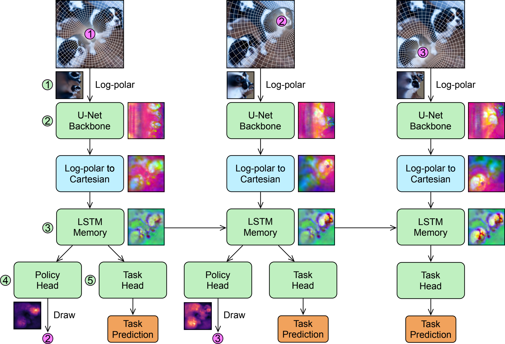

# FoAViS: Analyzing Learned Fixation Strategies in a Foveated Active Vision System

Official code for the paper *FoAViS: Analyzing Learned Fixation Strategies in a Foveated Active Vision System*
by Valentin Hassler, Jonathan Henrich, Yohaï-Eliel Berreby, Haoze Zhu and Alexander Ecker (under review at TMLR).

<p align="center"></p>

FoAViS looks at an image through a sequence of foveated glimpses. At each step it samples a log-polar glimpse
around the current fixation (1), encodes it with a Res-UNet backbone (2), maps the features back to image
coordinates and accumulates them in a 2D spatial memory with an LSTM cell per position (3). A policy head turns the
memory into a probability map from which the next fixation is drawn (4), and a task head reads the memory out for
classification or semantic segmentation (5). The policy is trained with a policy gradient concurrently with the
task. This repository contains the code to train the models of the paper (all except one appendix comparison, see
[Training](#training)) and to reproduce its main results (Tables 2 and 3) from the released checkpoints.

## Contents

- [Installation](#installation)
- [Data](#data)
- [Checkpoints](#checkpoints)
- [Quickstart](#quickstart)
- [Reproducing Tables 2 and 3](#reproducing-tables-2-and-3)
- [Training](#training)
- [Paper and code](#paper-and-code)
- [Tests](#tests)
- [Citation](#citation)

## Installation

```bash
conda env create -f environment.yml
conda activate foavis
pip install -e .
```

The environment pins the versions of the reported runs: Python 3.11, PyTorch 2.3.0 with CUDA 12.1, torchvision 0.18.0.

<details><summary>Packages</summary>

| Package | Version | Used for |
|---|---|---|
| pytorch, torchvision, pytorch-cuda | 2.3.0, 0.18.0, 12.1 | model, training |
| numpy | 1.26 | everywhere |
| pyarrow | 19.0 | scanpath files (Parquet) |
| pyyaml, dotmap | any recent, 1.3.30 | configs |
| pillow | 10.4 | image loading |
| tqdm | any recent | progress bars |
| wandb | 0.25.0 | optional logging (`--use_wandb true`) |
| pytest | any recent | tests |

</details>

## Data

All datasets live under one root, passed as `--data_dir` (default `./data`):

```
<data_dir>/
  MNIST/, EMNIST/             downloaded automatically on first use (C-MNIST)
  ImageNet/
    train_images/<wnid>/*.JPEG
    val/<wnid>/*.JPEG          validation images sorted into class folders
  ADEChallengeData2016/
    images/{training,validation}/*.jpg
    annotations/{training,validation}/*.png
  coco2017/{train2017,val2017}/*.jpg
  coco_stuff/{train2017,val2017}/*.png   stuffthingmaps (COCO-Stuff 164k)
```

C-MNIST is generated on the fly: each image places one MNIST digit (the target) and five EMNIST letters (the
distractors) on a 224 x 224 canvas (`foavis/data/cmnist.py`). Validation images are deterministic per
index, so every evaluation sees the same validation set.

## Checkpoints

One checkpoint per model of the paper, the first of the three seeds (8 files, ~0.45 GB), named
`<dataset>_<arm>_s1.pth` with `<dataset>` in `cmnist, imagenet, ade20k, coco_stuff` and `<arm>` in `random` (trained
with random fixation locations) or `learned` (trained with its own policy). Download: CHECKPOINT_LINK, into
`./checkpoints`. `imagenet_random_s1.pth` is also the initialisation of the segmentation models.

## Quickstart

```bash
python main.py --config_path configs/paper/cmnist_learned.yaml --just_evaluate true \
    --pretrained_model_path checkpoints/cmnist_learned_s1.pth
```

evaluates the C-MNIST learned-policy model with its own policy; the log ends with `'val_accuracy': 99.33`. The C-MNIST
column of Table 2:

```bash
bash reproduce/table2.sh cmnist && python reproduce/aggregate.py
```

## Reproducing Tables 2 and 3

```bash
export CKPT_DIR=./checkpoints DATA_DIR=./data   # the defaults
bash reproduce/table2.sh        # native policy evaluation
bash reproduce/table3.sh        # policy transfer
python reproduce/aggregate.py   # both tables, and a check of every value against reproduce/expected.csv
```

With the released checkpoints this evaluates seed 1: 24 cells for Table 2 and 42 for Table 3, 6 of them shared.
The passive baselines of Table 2 (top row) have no released checkpoints; they are reproduced by training them
(see [Training](#training)).
The paper reports mean and standard deviation over three seeds; models trained
with this code go into the same directory as `<dataset>_<arm>_s<seed>.pth` (ImageNet: the end of phase 2), and
`SEEDS="1 2 3"` evaluates all of them.

Each cell is one `main.py --just_evaluate` run on one GPU, logged to `reproduce_out/logs/`; results are collected in
`reproduce_out/cells.csv`. Finished cells are skipped when a script is rerun, so an interrupted run resumes, and a
dataset list runs datasets separately or in parallel (`bash reproduce/table2.sh imagenet`).

- Learned policies take the argmax of their probability map; triangle, quadrant and the map heuristics are
  deterministic too. These values match `expected.csv` up to GPU non-determinism (tolerance 0.05).
- Random-location cells draw new fixations at every evaluation (tolerance 0.5).
- A transferred policy is evaluated in two steps: the learned model of the policy's dataset records its fixations
  on the evaluated model's validation images (`reproduce_out/scanpaths/`), and these are replayed into the
  evaluated model.

## Training

Every model of the paper has a config in `configs/paper/`. Its header gives the command, the hardware of the
reported runs and their seeds; its body lists what differs from `configs/config_default.yaml`.

```bash
python main.py --config_path configs/paper/<model>.yaml --data_dir <data_dir> --seed <seed>
torchrun --nproc_per_node 4 main.py --config_path configs/paper/<model>.yaml ...   # batch_size is per GPU
```

Any config key can be overridden on the command line, by its name (`--num_glimpses 6`) or, where the name occurs in
several sections, by its path (`--memory.channels 64`). Checkpoints are written to
`model_ckpts/<dataset>/<timestamp>_<id>/`, with `last.pth` pointing to the latest.

The models build on each other:

```
C-MNIST          cmnist_{random,learned}                                   from scratch
ImageNet         imagenet_{random,learned}_phase1 -> ..._phase2            from scratch, then decay
ADE20K           ade20k_{random,learned}           <- imagenet_random_phase2 (first seed)
COCO-Stuff       coco_stuff_{random,learned}       <- imagenet_random_phase2 (first seed)
Passive          {cmnist,imagenet}_passive                                 from scratch
                 {ade20k,coco_stuff}_passive       <- imagenet_passive
```

| Config | Initialised from | Epochs | GPUs x batch per GPU | Time per run (reported runs) |
|---|---|---|---|---|
| `cmnist_random`, `cmnist_learned` | scratch | 400 | 1 x 64 | ~20 h, A100 |
| `imagenet_*_phase1` | scratch | 75 (constant learning rate) | 4 x 16 | ~35 h, 4x A100 or H100 |
| `imagenet_*_phase2` | phase 1 of the same arm and seed | 75 (step decay) | 4 x 16 | ~35 h, 4x A100 or H100 |
| `ade20k_random`, `ade20k_learned` | `imagenet_random_phase2`, first seed | 500 | 1 x 16 | 44-50 h, H100 |
| `coco_stuff_random`, `coco_stuff_learned` | `imagenet_random_phase2`, first seed | 72 | 1 x 16 | 43-49 h, H100 |
| `cmnist_passive`, `imagenet_passive` | scratch | 400, 150 | 1 x 64, 4 x 16 | |
| `ade20k_passive`, `coco_stuff_passive` | `imagenet_passive` | 500, 72 | 1 x 16 | |

With a different number of GPUs, keep GPUs x `batch_size` as in the table (ImageNet on 2 GPUs: `--batch_size 32`).
Training is not bit-reproducible on GPUs, so a retrained model matches a reported one up to seed variation.

Appendix models (each header names what differs from the corresponding main config):

| Configs | Paper |
|---|---|
| `*_learned_no_stopgrad`, `*_no_stopgrad_small_head`, `*_no_stopgrad_entropy` (4 datasets) | stop-gradient ablation |
| `ade20k_learned_no_stopgrad_lambda001` | stop-gradient ablation, policy-loss weight 0.01 |
| `imagenet_policy_only_{terminal,perstep}` | reward-horizon comparison (policy head only, on the frozen ImageNet random-location model) |

The ImageNet runs of the stop-gradient ablation correspond to phase 1 (75 epochs, constant learning rate) and are
compared with `imagenet_learned_phase1`. Not covered: the comparison of per-step and last-step task supervision,
whose models were trained with an earlier version of the code.

**Resuming an interrupted run.** Rerun the same command with

```bash
--pretrained_model_path model_ckpts/<dataset>/<run>/last.pth --resume_training true
```

## Paper and code

| Paper | Code | Config |
|---|---|---|
| Foveation module, glimpse (Sec. 3.1, Eq. 1) | `foavis/model/foveation.py` `LogPolarFoveation.glimpse` | `model.foveation` |
| Backbone, Res-UNet (Sec. 3.2) | `foavis/model/backbone.py` | `model.backbone` |
| Backprojection to the memory grid (Sec. 3.3) | `LogPolarFoveation.backproject` | `model.memory.grid_size` |
| Memory module, H_t (Sec. 3.3, Eq. 2) | `foavis/model/memory.py` | `model.memory` |
| Policy head psi, policy pi (Sec. 3.4, Eq. 3) | `foavis/model/heads.py` `PolicyHead`, `foavis/model/policy.py` `FixationSampler` | `model.policy_head` |
| Task head phi (Sec. 3.5, Eq. 4) | `ClassificationHead`, `SegmentationHead` in `heads.py` | |
| Episode of T steps, first fixation at the centre (Sec. 3.6) | `foavis/model/foavis.py` `FoAViS.forward` | `model.num_glimpses` |
| Task loss on every step (Eq. 5) | `foavis/core/losses.py` `LossCalculator.classification` / `.segmentation` | |
| Reward r_t (Eq. 6), standardization (Eq. 7) | `LossCalculator._add_policy_loss`, `.policy_loss` | `model.policy_loss.reward`, `.reward_standardization` |
| Policy loss with stop-grad (Eq. 8), total objective (Eq. 9) | `LossCalculator.policy_loss`; stop-grad in `FoAViS.forward` | `model.policy_loss.stop_grad`, `.weight` |
| Learned-policy / random-location models | | `model.policy`, `model.policy_loss.enabled` |
| Passive baselines (Sec. 4, Table 2) | `foavis/model/passive.py` `PassiveBaseline` | `model.passive_input_size` |
| Heuristic policies of Table 3 | `foavis/model/policy.py` | `model.policy`, `model.ior_radius` |
| Policy transfer (replayed scanpaths) | `foavis/io/scanpaths.py` | `utils.save_scanpaths`, `utils.replay_scanpaths` |

Fixations are in normalized image coordinates, `(-1, -1)` = top left, `(1, 1)` = bottom right.

Code layout:

```
main.py                  entry point: training and --just_evaluate
foavis/model/            foavis.py (the loop), foveation.py, backbone.py, memory.py, heads.py, policy.py,
                         passive.py (the passive baselines)
foavis/core/             losses.py (objective), trainer.py (training and evaluation loop)
foavis/data/             cmnist.py, imagenet.py, segmentation.py (ADE20K, COCO-Stuff), transforms.py, loaders.py
foavis/io/               checkpoint.py, scanpaths.py (recorded fixations), logger.py
foavis/utils/            parser.py (config and flags), config.py, distributed.py
configs/                 config_default.yaml (every key, commented) and configs/paper/ (one per model)
reproduce/               table2.sh, table3.sh, common.sh, aggregate.py, expected.csv
tests/                   unit tests and a one-epoch training smoke test
```

## Tests

```bash
DATA_DIR=<data_dir> python -m pytest tests/
```

The training test runs one short epoch per model type on a GPU (C-MNIST learned and random; ADE20K when present);
the other tests run on the CPU in seconds.

Working on the code with an AI coding assistant: `AGENTS.md` summarises the structure, the invariants and how to
check a change.

## Citation

```bibtex
@article{foavis,
  title   = {{FoAViS}: Analyzing Learned Fixation Strategies in a Foveated Active Vision System},
  author  = {Hassler, Valentin and Henrich, Jonathan and Berreby, Yoha{\"i}-Eliel and Zhu, Haoze and Ecker, Alexander},
  journal = {Under review at Transactions on Machine Learning Research},
  year    = {2026}
}
```

## License

MIT, see `LICENSE`.
